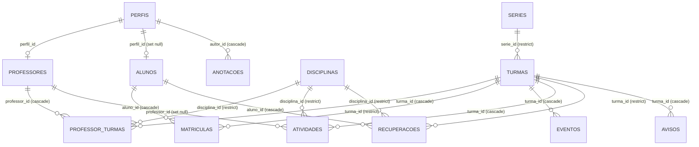

# Modelo relacional

Fonte: `database/schema.sql` (original, inalterado). Detalhes de políticas RLS: `docs/auditoria-fase1.md`, seção 3.3.

`auth.users (1) — (1) perfis`: o perfil é criado pela rota de criação de usuário (service role) ou manualmente para o primeiro administrador. `auditoria` é gravada apenas por trigger (perfis, alunos, matriculas, recuperacoes, professor_turmas).
